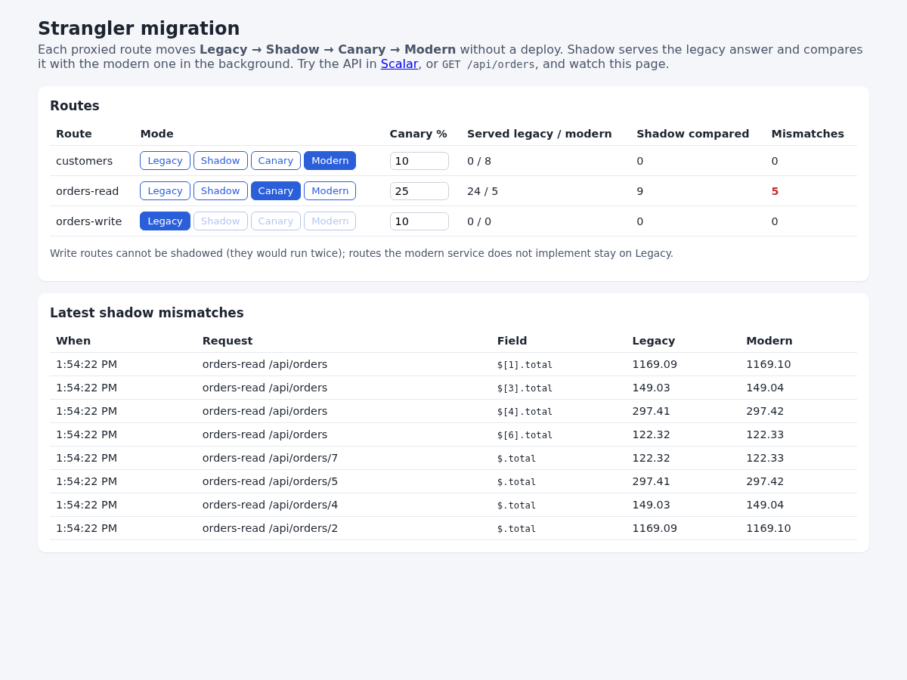
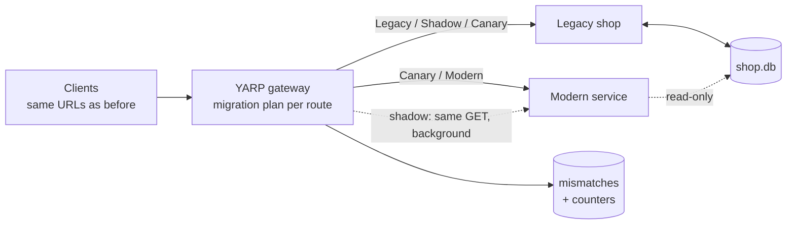

# Legacy Strangler · YARP

[](https://github.com/edybackend/legacy-strangler-yarp/actions/workflows/ci.yml)
[Leia em português](README.pt-BR.md)

Replacing a legacy system **one route at a time**, without a big-bang rewrite and without clients noticing. A **YARP**
gateway sits in front of the legacy shop and a new .NET 10 service. Each route has a migration mode, changed at runtime
and rolled back with one call:

**Legacy → Shadow → Canary → Modern**

In **Shadow** mode the gateway answers from the legacy service and replays the request against the modern one in the
background, comparing the JSON. That comparison found a real bug: the legacy service computes order totals with `double`
and truncates, so 4 of 8 orders were a cent short (`1299.00 × 0.9 = 1169.0999…` became `1169.09`).

Small on purpose: it can be read in about 15 minutes and started with one command.



## Quick start

Requirements: Docker.

```bash
docker compose up --build
```

Open http://localhost:8080 for the migration dashboard. Then call the API through the gateway:

```bash
curl -i localhost:8080/api/customers/1   # X-Served-By: modern  (already migrated)
curl -i localhost:8080/api/orders/2      # X-Served-By: legacy  (shadow: compared in the background)
curl localhost:8080/migration/api/mismatches
```

There is also a [`requests.http`](requests.http) walk-through. API reference: http://localhost:8080/scalar.

<details>
<summary>Without Docker (.NET 10 SDK, three terminals)</summary>

```bash
dotnet run --project src/Legacy.Api    # :8081, creates data/shop.db
dotnet run --project src/Modern.Api    # :8082, reads data/shop.db read-only
dotnet run --project src/Gateway       # :8080, dashboard and proxy
```
</details>

## How it works



- **Routing.** YARP matches the route from configuration (`customers`, `orders-read`, `orders-write`). A step in YARP's proxy pipeline then narrows the cluster's destinations to the one the plan picks, and tags the response with `X-Served-By`.
- **Shadow.** The legacy response is streamed to the client while a copy is kept. After the response, a background worker sends the same GET to the modern service and compares the two JSON documents by meaning: property order is ignored, `1169.1` equals `1169.10`, and strings must match exactly. The queue is bounded, so under load comparisons are dropped, never requests.
- **Canary.** A percentage of requests goes to the modern service. With an `X-Canary-Key` header (a customer id, say), one customer always lands on the same side instead of flipping between old and new.
- **Guardrails.**
  - A write route can never be shadowed: it would run twice.
  - A route the modern service does not implement (`ModernReady: false`) stays on Legacy.
  - Both rules are checked at startup and on every change.

## The migration, step by step

| Route | Starts at | Why |
|---|---|---|
| `customers` (GET) | **Modern** | migrated already; the parity test proves identical answers |
| `orders-read` (GET) | **Shadow** | being verified on real traffic: 4 differences on `$.total`, a bug in the legacy service |
| `orders-write` (POST) | **Legacy** | not implemented in the modern service yet; it cannot be shadowed |

Moving `orders-read` forward is a product decision once the evidence is in: correct the totals (modern) or keep the
legacy behaviour for compatibility. The dashboard shows the evidence; the plan changes with one `PUT`, and so does the rollback.

## How it is tested

| What | Test |
|---|---|
| Migrated route served by modern, byte-identical to legacy | `A_migrated_route_is_served_by_the_modern_service_with_the_same_answer` |
| Shadow serves legacy and flags exactly orders 2, 4, 5, 7 on `$.total` | `Shadow_serves_legacy_and_reports_exactly_the_orders_hit_by_the_rounding_bug` |
| Modern down → shadow clients unaffected, counted as shadow error | `When_the_modern_service_is_down_shadow_clients_are_not_affected` |
| Canary 0 % / 100 % / 30 % (60–120 of 300) and sticky keys | `Canary_sends_the_configured_share_and_sticks_per_key` |
| Unsafe changes refused (shadow a write, unready route, 150 %), rollback | `Unsafe_changes_are_refused_and_rollback_is_one_call` |
| Write through legacy, read through modern | `A_write_through_the_legacy_route_is_visible_through_the_modern_read` |
| Contract parity, outside the gateway: everything equal except the known rounding cases | `ParityTests` |
| The real three-container setup | CI job `compose`: modes, 4 mismatches, switch to Modern, `409` on shadowing a write |

The integration tests run the real YARP pipeline. A custom `IForwarderHttpClientFactory` delivers each forwarded request
to the legacy or modern test server, so there are no sockets and no ports.

## Tech stack

| Area | Choice |
|---|---|
| Gateway | YARP 2.3 (config-driven routes, proxy pipeline step), .NET 10 minimal APIs, Scalar |
| Services | ASP.NET Core minimal APIs, Dapper, SQLite (shared file, read-only for the modern service) |
| Quality | xUnit v3, WebApplicationFactory ×3, NetArchTest, Roslyn analyzers (warnings as errors) |
| Delivery | one Dockerfile for three services (`PROJECT` build arg), Docker Compose, GitHub Actions |

## Project structure

```
src/
  Legacy.Api/    the legacy shop: everything in one place, double totals (frozen during the migration)
  Modern.Api/    the new service: same contract, decimal totals, read-only data access
  Gateway/
    Migration/   plan per route, destination selector, proxy step, shadow comparer, JSON diff, admin API
    wwwroot/     the migration dashboard (plain HTML + JS)
tests/           unit (diff, rules, totals), integration (gateway end to end, parity) and architecture tests
specs/           feature specs (spec-first workflow)
```

## Design decisions

- **Per route, not per service.** A real migration moves one endpoint at a time; the plan has the same granularity.
- **Shadow before canary.** Shadow costs nothing to users and turns "we think it's the same" into a list of differences.
- **Compare by meaning.** A diff that flags `1169.1` vs `1169.10` or property order would be ignored within a week; this one only reports real differences.
- **Writes stay single.** No dual writes, no shadowed writes. The modern service reads the legacy database read-only until a write route gets its own store.
- **The plan is data.** Modes live in configuration and change at runtime; promoting and rolling back need no deploy.

## Known trade-offs

- **Shared database.** Reading the legacy database is the usual first step, but it couples the modern service to the legacy schema. The next step is its own store, filled by change data capture or events, before any write route moves.
- **In-memory plan and evidence.** Mode changes and mismatches reset when the gateway restarts (it starts from configuration). With several gateway instances, the plan would live in a shared store.
- **Shadow doubles read load** on the modern service and on the database. It is meant for a verification window, not forever.
- **Shadowed GETs must be safe.** A legacy GET with side effects (an audit log, a counter) would run twice on the modern side if it also had them.

## AI-Assisted Engineering

This project was built with Claude Code under explicit engineering controls:

- **Project rules** ([`CLAUDE.md`](CLAUDE.md)) define the migration rules the agent must follow.
- **Hooks** ([`.claude/settings.json`](.claude/settings.json)) format every change, block edits to secrets and databases, **block changes to the frozen legacy service**, **block SQL writes in the modern service**, and run the build and tests before a task is considered done.
- **Spec-first**: each feature starts as a spec in [`specs/`](specs) with acceptance criteria.
- **Same quality gates for every line**: CI enforces warnings as errors, formatting, unit/integration/parity/architecture tests, a three-container migration run and secret scanning.

I own the architecture and review every change.

## License

[MIT](LICENSE)
