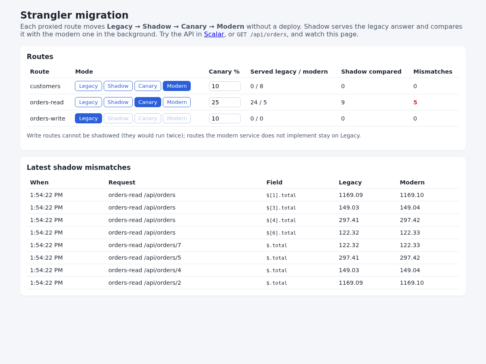
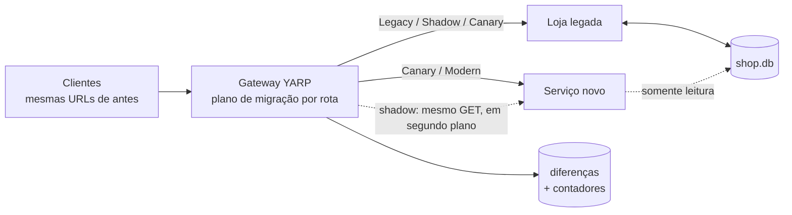

# Legacy Strangler · YARP

[](https://github.com/edybackend/legacy-strangler-yarp/actions/workflows/ci.yml)
[Read in English](README.md)

Substituir um sistema legado **uma rota por vez**, sem reescrever tudo de uma vez e sem os clientes perceberem. Um
gateway **YARP** fica na frente da loja legada e de um serviço novo em .NET 10. Cada rota tem um modo de migração,
trocado em tempo de execução e revertido com uma chamada:

**Legacy → Shadow → Canary → Modern**

No modo **Shadow**, o gateway responde com o legado e repete a requisição no serviço novo em segundo plano, comparando o
JSON. Essa comparação achou um bug real: o legado calcula o total do pedido em `double` e trunca, então 4 de 8 pedidos
ficavam um centavo abaixo (`1299,00 × 0,9 = 1169,0999…` virava `1169,09`).



## Como rodar

Requisito: Docker.

```bash
docker compose up --build
```

Abra http://localhost:8080 para ver o painel da migração. Depois chame a API pelo gateway:

```bash
curl -i localhost:8080/api/customers/1   # X-Served-By: modern  (já migrada)
curl -i localhost:8080/api/orders/2      # X-Served-By: legacy  (shadow: comparada em segundo plano)
curl localhost:8080/migration/api/mismatches
```

Há também o roteiro [`requests.http`](requests.http). Referência da API: http://localhost:8080/scalar.

<details>
<summary>Sem Docker (.NET 10 SDK, três terminais)</summary>

```bash
dotnet run --project src/Legacy.Api    # :8081, cria data/shop.db
dotnet run --project src/Modern.Api    # :8082, lê data/shop.db em modo somente leitura
dotnet run --project src/Gateway       # :8080, painel e proxy
```
</details>

## Como funciona



- **Roteamento.** O YARP casa a rota pela configuração (`customers`, `orders-read`, `orders-write`). Um passo no pipeline do proxy reduz os destinos do cluster ao que o plano escolhe e marca a resposta com `X-Served-By`.
- **Shadow.** A resposta do legado vai para o cliente enquanto uma cópia é guardada. Depois, um worker em segundo plano manda o mesmo GET ao serviço novo e compara os dois JSON pelo significado: ignora a ordem das propriedades, `1169.1` é igual a `1169.10`, e textos precisam bater exatamente. A fila é limitada: sob carga, descarta comparações, nunca requisições.
- **Canary.** Uma porcentagem das requisições vai para o serviço novo. Com o cabeçalho `X-Canary-Key` (o id de um cliente, por exemplo), o mesmo cliente cai sempre do mesmo lado, sem alternar entre o comportamento antigo e o novo.
- **Travas de segurança.**
  - Rota de escrita nunca entra em shadow, porque rodaria duas vezes.
  - Rota que o serviço novo ainda não implementa (`ModernReady: false`) fica no legado.
  - As duas regras valem na inicialização e a cada mudança.

## A migração, passo a passo

| Rota | Começa em | Por quê |
|---|---|---|
| `customers` (GET) | **Modern** | já migrada; o teste de paridade prova respostas idênticas |
| `orders-read` (GET) | **Shadow** | em verificação com tráfego real: 4 diferenças em `$.total`, um bug do legado |
| `orders-write` (POST) | **Legacy** | o serviço novo ainda não implementa; não pode entrar em shadow |

Avançar `orders-read` é uma decisão de produto depois das evidências: corrigir os totais (serviço novo) ou manter o
comportamento do legado por compatibilidade. O painel mostra as evidências; o plano muda com um `PUT`, e o rollback também.

## Como é testado

| O quê | Teste |
|---|---|
| Rota migrada servida pelo novo, idêntica ao legado | `A_migrated_route_is_served_by_the_modern_service_with_the_same_answer` |
| Shadow serve o legado e aponta exatamente os pedidos 2, 4, 5 e 7 em `$.total` | `Shadow_serves_legacy_and_reports_exactly_the_orders_hit_by_the_rounding_bug` |
| Serviço novo fora → clientes do shadow não são afetados; conta como erro de shadow | `When_the_modern_service_is_down_shadow_clients_are_not_affected` |
| Canary 0 % / 100 % / 30 % (60–120 de 300) e chave fixa | `Canary_sends_the_configured_share_and_sticks_per_key` |
| Mudanças inseguras recusadas (shadow em escrita, rota não pronta, 150 %), rollback | `Unsafe_changes_are_refused_and_rollback_is_one_call` |
| Escrita pelo legado, leitura pelo novo | `A_write_through_the_legacy_route_is_visible_through_the_modern_read` |
| Paridade do contrato, fora do gateway: tudo igual, exceto os casos de arredondamento conhecidos | `ParityTests` |
| O ambiente real com três contêineres | job `compose` do CI: modos, 4 diferenças, troca para Modern, `409` ao pôr escrita em shadow |

Os testes de integração rodam o pipeline real do YARP. Um `IForwarderHttpClientFactory` próprio entrega cada requisição
encaminhada ao TestServer do legado ou do serviço novo, sem sockets nem portas.

## Tecnologias

| Área | Escolha |
|---|---|
| Gateway | YARP 2.3 (rotas por configuração, passo no pipeline do proxy), minimal APIs .NET 10, Scalar |
| Serviços | ASP.NET Core minimal APIs, Dapper, SQLite (arquivo compartilhado, somente leitura no serviço novo) |
| Qualidade | xUnit v3, WebApplicationFactory ×3, NetArchTest, analisadores Roslyn (avisos viram erro) |
| Entrega | um Dockerfile para três serviços (build arg `PROJECT`), Docker Compose, GitHub Actions |

## Estrutura

```
src/
  Legacy.Api/    a loja legada: tudo num lugar só, totais em double (congelada durante a migração)
  Modern.Api/    o serviço novo: mesmo contrato, totais em decimal, acesso somente leitura
  Gateway/
    Migration/   plano por rota, seletor de destino, passo do proxy, comparador shadow, diff de JSON, API de admin
    wwwroot/     o painel da migração (HTML + JS puros)
tests/           unidade (diff, regras, totais), integração (gateway de ponta a ponta, paridade) e arquitetura
specs/           especificações (spec primeiro)
```

## Decisões de design

- **Por rota, não por serviço.** Uma migração real move um endpoint por vez; o plano tem a mesma granularidade.
- **Shadow antes do canary.** O shadow não custa nada ao usuário e transforma "achamos que está igual" numa lista de diferenças.
- **Comparar pelo significado.** Um diff que reclama de `1169.1` × `1169.10` ou de ordem de propriedades seria ignorado em uma semana; este só aponta diferenças reais.
- **Escrita num lugar só.** Sem escrita dupla, sem escrita em shadow. O serviço novo lê o banco do legado em modo somente leitura até uma rota de escrita ganhar o próprio banco.
- **O plano é dado.** Os modos ficam na configuração e mudam em tempo de execução; promover e reverter não exigem deploy.

## Trade-offs conhecidos

- **Banco compartilhado.** Ler o banco do legado é o primeiro passo comum, mas acopla o serviço novo ao esquema antigo. O próximo passo é um banco próprio, alimentado por CDC ou eventos, antes de mover qualquer rota de escrita.
- **Plano e evidências em memória.** As mudanças de modo e as diferenças zeram quando o gateway reinicia (ele parte da configuração). Com várias instâncias do gateway, o plano ficaria num armazenamento compartilhado.
- **O shadow dobra a carga de leitura** no serviço novo e no banco. Serve para uma janela de verificação, não para sempre.
- **GETs em shadow precisam ser seguros.** Um GET do legado com efeito colateral (log de auditoria, contador) rodaria duas vezes no lado novo, se ele também tivesse esse efeito.

## Trabalhando com um agente de IA

Durante a migração o legado fica congelado e o serviço novo só lê o banco antigo. As duas regras são impostas por hooks em [`.claude/`](.claude) quando trabalho com um agente de IA: edições em `Legacy.Api` são recusadas, assim como qualquer SQL de escrita em `Modern.Api`. O [`CLAUDE.md`](CLAUDE.md) descreve os passos da migração.

## Licença

[MIT](LICENSE)
